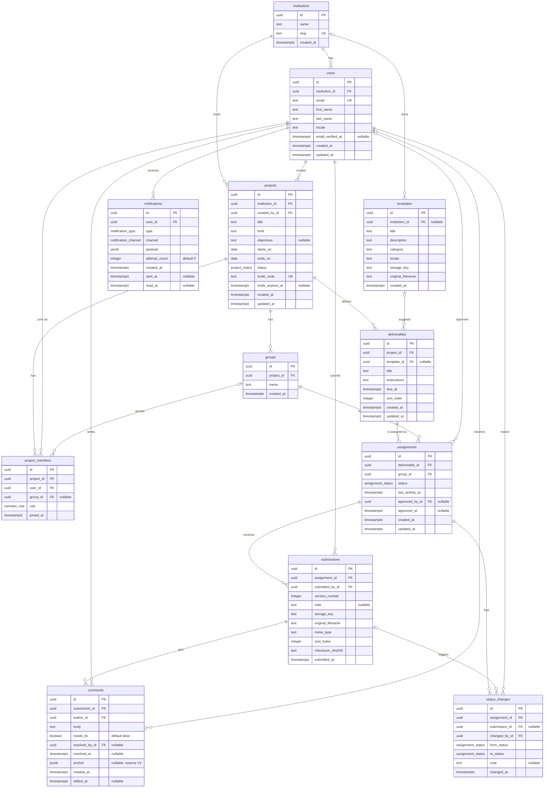

# Pentimento : ERD du MVP

Modèle de données du MVP (PostgreSQL). Conventions : tables au pluriel, `snake_case`, `_id` = clé étrangère, `_at` = instant (`timestamptz`), `_on` = jour (`date`), `_by_id` = utilisateur auteur d'une action, `needs_` = booléen.

## Comment lire le diagramme

Notation « patte de corbeau » (crow's foot), à lire du côté de la table jusqu'au symbole :

| Symbole | Signification |
|---|---|
| `\|\|` | exactement un |
| `\|o` | zéro ou un (la clé étrangère est nullable) |
| `o{` | zéro ou plusieurs |

Exemple : `projects ||--o{ groups` se lit « un projet a zéro ou plusieurs groupes, et un groupe appartient à exactement un projet ».

## Types énumérés

| Type | Valeurs |
|---|---|
| `project_status` | `draft`, `active`, `archived` |
| `member_role` | `teacher`, `student` |
| `assignment_status` | `to_submit`, `awaiting_review`, `changes_requested`, `approved` |
| `notification_type` | `submission_received`, `changes_requested`, `approved` |
| `notification_channel` | `email`, `in_app` |

## Contraintes que le diagramme ne montre pas

**Unicités composées**

- `project_members` : (`project_id`, `user_id`)
- `assignments` : (`deliverable_id`, `group_id`)
- `submissions` : (`assignment_id`, `version_number`)

**Cohérence entre tables** : le `group_id` d'un `project_members` doit appartenir au même projet que lui (clé composite ou contrôle dans la couche service).

**Immuabilité** : `submissions` et `status_changes` ne reçoivent jamais d'`UPDATE` ni de `DELETE`.

**Suppression** : pas de `ON DELETE CASCADE` sur ce qui contient du travail d'étudiant ; les projets s'archivent.

**Index prévus** : `project_members(user_id)`, `assignments(group_id, status)`, `assignments(status, last_activity_at)`, `submissions(assignment_id)`, `comments(submission_id)`.

## Prévu pour la V2, non construit

`institution_id` partout (SSO, facturation), `comments.anchor` (annotations), `notifications.channel = in_app`, `status_changes` (statistiques), `users.locale` (langues), versions comme entité à part (comparaison visuelle).
